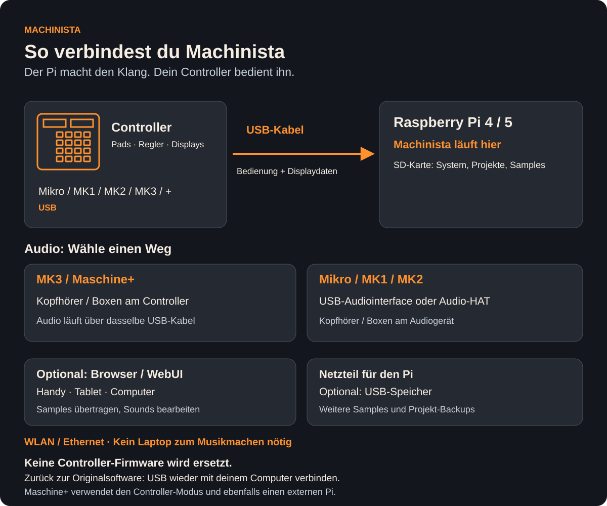

# Machinista: Musik machen mit deinem Controller

Baue Beats, spiele Instrumente und mache aus Loops einen Song. Machinista läuft
auf einem Raspberry Pi und wird mit deinem Controller bedient. Beim Musikmachen
brauchst du keinen angeschlossenen Laptop. Der eingebaute Synthesizer bringt
fertige Klänge mit. Eigene Samples kannst du aufnehmen oder hochladen.

## So wird es angeschlossen

**Der Pi erzeugt den Klang. Der Controller stellt Pads, Regler und Displays bereit.**
Die Controller-Firmware wird nicht ersetzt. Für die ursprüngliche Maschine-Software
schließt du den Controller einfach wieder per USB an deinen Computer an.

- **MK3 / Maschine+:** Das eingebaute Audiointerface funktioniert. Kopfhörer oder
  Lautsprecher kommen an den Controller; Audio und Bedienung nutzen dasselbe USB-Kabel.
- **Mikro / MK1 / MK2:** Du brauchst ein unterstütztes USB-Audiointerface oder
  Audio-HAT am Pi. Dort schließt du Kopfhörer oder Lautsprecher an.
- **Speicher:** Die SD-Karte enthält das System und kann auch Samples und Projekte
  speichern. Ein USB-Laufwerk ist eine optionale Erweiterung.
- **WebUI:** Handy, Tablet oder Computer sind für Dateiverwaltung und detailliertes
  Bearbeiten optional. Zum normalen Musikmachen genügt der Controller mit dem Pi.
- **Maschine+:** Controller-Modus und externer Pi; kein Austausch des internen Systems.

Ein Computer wird einmal zum Beschreiben der SD-Karte benötigt. Der Pi ist selbst
auch ein Computer, aber beim Spielen brauchst du daneben keinen Laptop oder Monitor.
[Einrichtung Schritt für Schritt](INSTALL.md) · [Passende Plug-in-Downloads](PLUGIN_PORTS.md)

## Was kann ich damit machen?

- **Beats bauen:** Drums auf den Pads einspielen oder Anschläge Schritt für
  Schritt setzen. Einzelne Noten lassen sich danach korrigieren.
- **Samples bearbeiten:** WAV- und MP3-Dateien laden, aufnehmen, kürzen und in
  spielbare Abschnitte schneiden. Aus mehreren Aufnahmen entsteht ein Instrument
  für die Tastatur, zum Beispiel ein gesampeltes E-Piano.
- **Synthesizer spielen:** Einen fertigen Klang wählen und nach Geschmack
  verändern. Ein Patch ist eine gespeicherte Klangeinstellung; eine Bank ist
  eine Sammlung solcher Klänge.
- **Akkorde und Melodien spielen:** Die Pads als Klaviertasten nutzen,
  Tonleitern wählen oder einen ganzen Akkord auf ein Pad legen.
- **Songs aufbauen:** Patterns sind wiederholte musikalische Phrasen. Scenes
  verbinden sie zu Songteilen, die du anschließend in eine Reihenfolge bringst.
- **Live spielen:** Parts stummschalten, Lautstärken mischen und Effekte mit den
  Pads spielen. Reglerbewegungen lassen sich aufnehmen und wiedergeben.
- **Loops aufnehmen und weiterverwenden:** Eine laufende Passage als Audio auf
  ein anderes Pad aufnehmen und damit weiterarbeiten.
- **Instrumente und Effekte ergänzen:** Passende LV2-Plug-ins installieren.
  LV2 ist das Format für diese Erweiterungen. Das öffentliche Image enthält
  keine Plug-ins von Drittanbietern.
- **Externes Equipment nutzen:** Über MIDI ein Keyboard anschließen oder einen
  Synthesizer ansteuern. MIDI überträgt Noten und Steuerbefehle; für den Klang
  eines externen Instruments brauchst du zusätzlich eine Audioverbindung.
- **Dateien einfach verwalten:** Samples am Handy, Tablet oder Computer über
  die Browserseite hochladen, Sounds ordnen und Projekte sichern. Diese Seite
  heißt WebUI. Eine zusätzliche App ist nicht nötig.

## Was brauche ich?

Einen Raspberry Pi 4 oder 5 mit Netzteil, eine SD-Karte mit mindestens 8 GB,
einen unterstützten Controller und ein unterstütztes Audiogerät für Kopfhörer
oder Lautsprecher. Ein Computer wird zum Vorbereiten der SD-Karte gebraucht.
Das Image ist eine fertig vorbereitete Systemdatei. Du musst nichts programmieren
oder selbst aus Quellcode bauen.

Unterstützt werden Mikro MK1/MK2, MK1, MK2, MK3 und Maschine+ im Controller-Modus.
Bei der Maschine+ läuft Machinista ebenfalls auf dem angeschlossenen Pi, nicht
als Ersatz für das interne Standalone-System.

Beginne mit der [Anleitung für deinen Controller](USER_MANUALS.md). Sie führt
von der Einrichtung zum ersten eingebauten Sound und zum ersten Beat. Danach
kannst du weitere Kapitel nach Bedarf nachschlagen. Die Menüs und Displays
bleiben englisch; die deutsche Anleitung erklärt die Begriffe dazu.

**Aktuell ist Machinista eine Beta zum Ausprobieren und Testen.** Sichere wichtige
Projekte. Unterschiedliche Controller, Audiogeräte und Pi-Modelle müssen noch
im praktischen Betrieb geprüft werden. Das öffentliche Image enthält
Synth-Klänge, aber kein Drum-Samplepaket und keine eigenen Aufnahmen.
